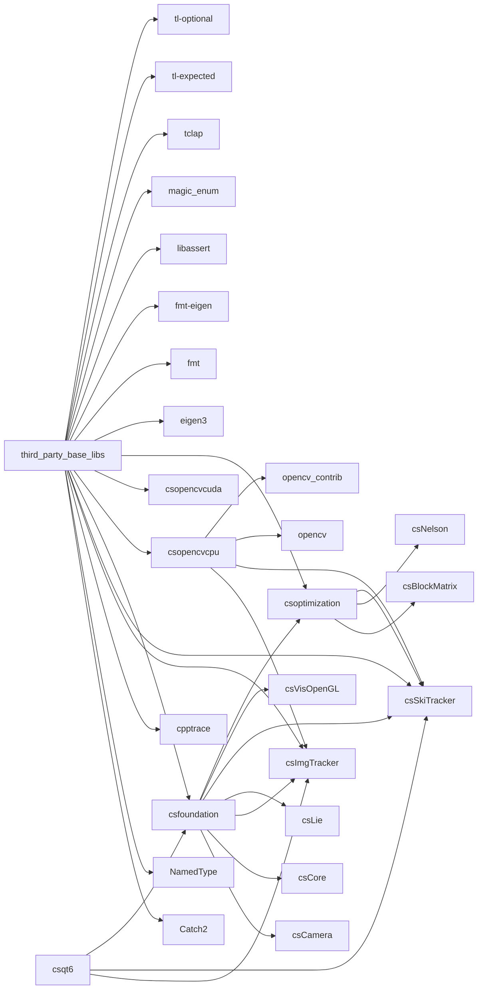

# The cscosine ecosystem

Generated by `scripts/ecosystem_report.py` from GitHub (nightly: `.github/workflows/ecosystem.yml`). Do not
edit: change the repositories, or the script.

## Needs attention

- [csBlockMatrix](https://github.com/cscosine/csBlockMatrix)
  - template v0.3.0, latest is v0.3.2 (`copier update`)
- [csCamera](https://github.com/cscosine/csCamera)
  - template v0.3.0, latest is v0.3.2 (`copier update`)
- [csCMake](https://github.com/cscosine/csCMake)
  - `stable` is not at a final release (last final: v0.4.0)
  - template v0.2.5, latest is v0.3.2 (`copier update`)
- [csCore](https://github.com/cscosine/csCore)
  - template v0.3.0, latest is v0.3.2 (`copier update`)
- [csfoundation](https://github.com/cscosine/csfoundation)
  - csCMake 1.0.0-rc8, latest is v1.0.0-rc9
  - pins third_party_base_libs v0.1.0-rc10, latest is v0.1.0-rc11
  - template v0.3.0, latest is v0.3.2 (`copier update`)
- [csImgTracker](https://github.com/cscosine/csImgTracker)
  - `stable` is not at a final release (last final: v0.2.1)
  - csCMake 1.0.0-rc8, latest is v1.0.0-rc9
  - pins third_party_base_libs v0.1.0-rc10, latest is v0.1.0-rc11
  - template v0.3.0, latest is v0.3.2 (`copier update`)
- [csLie](https://github.com/cscosine/csLie)
  - template v0.3.0, latest is v0.3.2 (`copier update`)
- [csNelson](https://github.com/cscosine/csNelson)
  - template v0.3.0, latest is v0.3.2 (`copier update`)
- [csopencvcpu](https://github.com/cscosine/csopencvcpu)
  - csCMake 1.0.0-rc8, latest is v1.0.0-rc9
  - pins third_party_base_libs v0.1.0-rc10, latest is v0.1.0-rc11
  - template v0.2.5, latest is v0.3.2 (`copier update`)
- [csopencvcuda](https://github.com/cscosine/csopencvcuda)
  - csCMake 1.0.0-rc2, latest is v1.0.0-rc9
  - pins third_party_base_libs v0.1.0-rc6, latest is v0.1.0-rc11
- [csoptimization](https://github.com/cscosine/csoptimization)
  - csCMake 1.0.0-rc8, latest is v1.0.0-rc9
  - pins third_party_base_libs v0.1.0-rc10, latest is v0.1.0-rc11
  - template v0.3.0, latest is v0.3.2 (`copier update`)
- [csorchestrator](https://github.com/cscosine/csorchestrator)
  - template v0.2.5, latest is v0.3.2 (`copier update`)
- [csqt6](https://github.com/cscosine/csqt6)
  - 8 commit(s) on `main` since v6.12.0-rc1
  - template v0.2.5, latest is v0.3.2 (`copier update`)
- [csSkiTracker](https://github.com/cscosine/csSkiTracker)
  - csCMake 1.0.0-rc8, latest is v1.0.0-rc9
  - pins third_party_base_libs v0.1.0-rc10, latest is v0.1.0-rc11
  - template v0.3.1, latest is v0.3.2 (`copier update`)
- [csVisOpenGL](https://github.com/cscosine/csVisOpenGL)
  - template v0.3.0, latest is v0.3.2 (`copier update`)
- [csWiki](https://github.com/cscosine/csWiki)
  - template v0.2.5, latest is v0.3.2 (`copier update`)
- [fmt-eigen](https://github.com/cscosine/fmt-eigen)
  - template v0.3.1, latest is v0.3.2 (`copier update`)
- [NamedType](https://github.com/cscosine/NamedType)
  - template v0.3.1, latest is v0.3.2 (`copier update`)
- [tclap](https://github.com/cscosine/tclap)
  - template v0.3.1, latest is v0.3.2 (`copier update`)
- [third_party_base_libs](https://github.com/cscosine/third_party_base_libs)
  - 2 commit(s) on `main` since v0.1.0-rc11
  - csCMake 1.0.0-rc8, latest is v1.0.0-rc9
  - template v0.3.1, latest is v0.3.2 (`copier update`)

## Versions (outer projects)

| Project | Final | Candidate | Commits on main since | stable |
|---|---|---|---|---|
| [cs-project-template](https://github.com/cscosine/cs-project-template) | – | – | – | – |
| [csCMake](https://github.com/cscosine/csCMake) | v0.4.0 | v1.0.0-rc9 | 0 | not at the last final |
| [csfoundation](https://github.com/cscosine/csfoundation) | – | v0.1.0-rc11 | 0 | – |
| [csImgTracker](https://github.com/cscosine/csImgTracker) | v0.2.1 | v0.2.2-rc2 | 0 | not at the last final |
| [csopencvcpu](https://github.com/cscosine/csopencvcpu) | – | v5.1.0-cpu.3-rc1 | 0 | – |
| [csopencvcuda](https://github.com/cscosine/csopencvcuda) | – | v5.0.1-rc3 | 0 | – |
| [csoptimization](https://github.com/cscosine/csoptimization) | – | v0.1.0-rc7 | 0 | – |
| [csorchestrator](https://github.com/cscosine/csorchestrator) | – | – | – | – |
| [csqt6](https://github.com/cscosine/csqt6) | – | v6.12.0-rc1 | 8 | – |
| [csSkiTracker](https://github.com/cscosine/csSkiTracker) | – | v0.1.0-rc5 | 0 | – |
| [csWiki](https://github.com/cscosine/csWiki) | – | – | – | – |
| [third_party_base_libs](https://github.com/cscosine/third_party_base_libs) | – | v0.1.0-rc11 | 2 | – |

## Dependencies (recipes on `main`)

| Project | csCMake | Providers (pinned release) | Builds (inner repository at ref) |
|---|---|---|---|
| [csfoundation](https://github.com/cscosine/csfoundation) | 1.0.0-rc8 | [third_party_base_libs `v0.1.0-rc10`](https://github.com/cscosine/third_party_base_libs/releases/tag/v0.1.0-rc10) [csqt6 `v6.12.0-rc1`](https://github.com/cscosine/csqt6/releases/tag/v6.12.0-rc1) | [csCore `main`](https://github.com/cscosine/csCore/tree/main) [csLie `main`](https://github.com/cscosine/csLie/tree/main) [csCamera `main`](https://github.com/cscosine/csCamera/tree/main) [csVisOpenGL `main`](https://github.com/cscosine/csVisOpenGL/tree/main) |
| [csImgTracker](https://github.com/cscosine/csImgTracker) | 1.0.0-rc8 | [third_party_base_libs `v0.1.0-rc10`](https://github.com/cscosine/third_party_base_libs/releases/tag/v0.1.0-rc10) [csfoundation `v0.1.0-rc11`](https://github.com/cscosine/csfoundation/releases/tag/v0.1.0-rc11) [csqt6 `v6.12.0-rc1`](https://github.com/cscosine/csqt6/releases/tag/v6.12.0-rc1) [csopencvcpu `v5.1.0-cpu.3-rc1`](https://github.com/cscosine/csopencvcpu/releases/tag/v5.1.0-cpu.3-rc1) | – |
| [csopencvcpu](https://github.com/cscosine/csopencvcpu) | 1.0.0-rc8 | [third_party_base_libs `v0.1.0-rc10`](https://github.com/cscosine/third_party_base_libs/releases/tag/v0.1.0-rc10) | [opencv `v5.1.0-cpu.3`](https://github.com/cscosine/opencv/tree/v5.1.0-cpu.3) [opencv_contrib `v5.1.0-cpu.3`](https://github.com/cscosine/opencv_contrib/tree/v5.1.0-cpu.3) |
| [csopencvcuda](https://github.com/cscosine/csopencvcuda) | 1.0.0-rc2 | [third_party_base_libs `v0.1.0-rc6`](https://github.com/cscosine/third_party_base_libs/releases/tag/v0.1.0-rc6) | – |
| [csoptimization](https://github.com/cscosine/csoptimization) | 1.0.0-rc8 | [csfoundation `v0.1.0-rc11`](https://github.com/cscosine/csfoundation/releases/tag/v0.1.0-rc11) [third_party_base_libs `v0.1.0-rc10`](https://github.com/cscosine/third_party_base_libs/releases/tag/v0.1.0-rc10) | [csNelson `main`](https://github.com/cscosine/csNelson/tree/main) [csBlockMatrix `main`](https://github.com/cscosine/csBlockMatrix/tree/main) |
| [csqt6](https://github.com/cscosine/csqt6) | – | – | – |
| [csSkiTracker](https://github.com/cscosine/csSkiTracker) | 1.0.0-rc8 | [third_party_base_libs `v0.1.0-rc10`](https://github.com/cscosine/third_party_base_libs/releases/tag/v0.1.0-rc10) [csfoundation `v0.1.0-rc11`](https://github.com/cscosine/csfoundation/releases/tag/v0.1.0-rc11) [csoptimization `v0.1.0-rc7`](https://github.com/cscosine/csoptimization/releases/tag/v0.1.0-rc7) [csqt6 `v6.12.0-rc1`](https://github.com/cscosine/csqt6/releases/tag/v6.12.0-rc1) [csopencvcpu `v5.1.0-cpu.3-rc1`](https://github.com/cscosine/csopencvcpu/releases/tag/v5.1.0-cpu.3-rc1) | – |
| [third_party_base_libs](https://github.com/cscosine/third_party_base_libs) | 1.0.0-rc8 | – | [eigen3 `v5.0.1-cs.2`](https://github.com/cscosine/eigen3/tree/v5.0.1-cs.2) [fmt `v12.2.1-cs.2`](https://github.com/cscosine/fmt/tree/v12.2.1-cs.2) [cpptrace `v1.0.4-cs.2`](https://github.com/cscosine/cpptrace/tree/v1.0.4-cs.2) [libassert `v2.2.1-cs.2`](https://github.com/cscosine/libassert/tree/v2.2.1-cs.2) [magic_enum `v0.9.8-cs.2`](https://github.com/cscosine/magic_enum/tree/v0.9.8-cs.2) [Catch2 `v3.16.1-cs.2`](https://github.com/cscosine/Catch2/tree/v3.16.1-cs.2) [tl-expected `v1.3.1-cs.2`](https://github.com/cscosine/tl-expected/tree/v1.3.1-cs.2) [tl-optional `v1.1.0-cs.2`](https://github.com/cscosine/tl-optional/tree/v1.1.0-cs.2) [NamedType `v1.1.0-rc1`](https://github.com/cscosine/NamedType/tree/v1.1.0-rc1) [tclap `v1.0.0-rc1`](https://github.com/cscosine/tclap/tree/v1.0.0-rc1) [fmt-eigen `v1.0.0-rc1`](https://github.com/cscosine/fmt-eigen/tree/v1.0.0-rc1) |

## Project template

Latest template: v0.3.2

| Repository | Kind | Template | Answers |
|---|---|---|---|
| [csBlockMatrix](https://github.com/cscosine/csBlockMatrix) | library | v0.3.0 | kind=library |
| [csCamera](https://github.com/cscosine/csCamera) | library | v0.3.0 | kind=library |
| [csCMake](https://github.com/cscosine/csCMake) | tool | v0.2.5 | kind=tool |
| [csCore](https://github.com/cscosine/csCore) | library | v0.3.0 | kind=library |
| [csfoundation](https://github.com/cscosine/csfoundation) | distribution | v0.3.0 | csorchestrator_version=v0.1.0-rc1, kind=project, workspace_dir=workspace |
| [csImgTracker](https://github.com/cscosine/csImgTracker) | application | v0.3.0 | csorchestrator_version=v0.1.0-rc1, kind=project, workspace_dir=workspace |
| [csLie](https://github.com/cscosine/csLie) | library | v0.3.0 | kind=library |
| [csNelson](https://github.com/cscosine/csNelson) | library | v0.3.0 | kind=library |
| [csopencvcpu](https://github.com/cscosine/csopencvcpu) | distribution | v0.2.5 | csorchestrator_version=v0.1.0-rc1, kind=project, workspace_dir=workspace |
| [csoptimization](https://github.com/cscosine/csoptimization) | distribution | v0.3.0 | csorchestrator_version=v0.1.0-rc1, kind=project, workspace_dir=workspace |
| [csorchestrator](https://github.com/cscosine/csorchestrator) | tool | v0.2.5 | kind=tool |
| [csqt6](https://github.com/cscosine/csqt6) | distribution | v0.2.5 | csorchestrator_version=v0.1.0-rc1, kind=project, workspace_dir=workspace |
| [csSkiTracker](https://github.com/cscosine/csSkiTracker) | application | v0.3.1 | csorchestrator_version=v0.1.0-rc1, kind=project, workspace_dir=workspace |
| [csVisOpenGL](https://github.com/cscosine/csVisOpenGL) | library | v0.3.0 | kind=library |
| [csWiki](https://github.com/cscosine/csWiki) | tool | v0.2.5 | kind=tool |
| [fmt-eigen](https://github.com/cscosine/fmt-eigen) | library | v0.3.1 | kind=library |
| [NamedType](https://github.com/cscosine/NamedType) | library | v0.3.1 | kind=library |
| [tclap](https://github.com/cscosine/tclap) | library | v0.3.1 | kind=library |
| [third_party_base_libs](https://github.com/cscosine/third_party_base_libs) | distribution | v0.3.1 | csorchestrator_version=v0.1.0-rc1, kind=project, workspace_dir=workspace |

Not on the template yet: [csopencvcuda](https://github.com/cscosine/csopencvcuda).

## Forks

A fork is an upstream release plus our commits (`cscosine/README.md` in the fork says why each one exists);
syncs: the `cs-fork-sync` skill.

| Fork | Upstream | Base | Our commits | Our tags on it | Newer upstream releases |
|---|---|---|---|---|---|
| [Catch2](https://github.com/cscosine/Catch2) | https://github.com/catchorg/Catch2 | `v3.16.1` | 2 | v3.16.1-cs.1, v3.16.1-cs.2 | – |
| [cpptrace](https://github.com/cscosine/cpptrace) | https://github.com/jeremy-rifkin/cpptrace | `v1.0.4` | 4 | v1.0.4-cs.1, v1.0.4-cs.2 | – |
| [eigen3](https://github.com/cscosine/eigen3) | https://gitlab.com/libeigen/eigen | `5.0.1` | 3 | v5.0.1-cs.1, v5.0.1-cs.2 | – |
| [fmt](https://github.com/cscosine/fmt) | https://github.com/fmtlib/fmt | `12.2.1` | 3 | v12.2.1-cs.1, v12.2.1-cs.2 | – |
| [libassert](https://github.com/cscosine/libassert) | https://github.com/jeremy-rifkin/libassert | `v2.2.1` | 5 | v2.2.1-cs.1, v2.2.1-cs.2 | – |
| [magic_enum](https://github.com/cscosine/magic_enum) | https://github.com/Neargye/magic_enum | `v0.9.8` | 3 | v0.9.8-cs.1, v0.9.8-cs.2 | – |
| [opencv](https://github.com/cscosine/opencv) | https://github.com/opencv/opencv | `5.1.0` | 8 | v5.1.0-cpu.1, v5.1.0-cpu.2, v5.1.0-cpu.3 | – |
| [opencv_contrib](https://github.com/cscosine/opencv_contrib) | https://github.com/opencv/opencv_contrib | `5.1.0` | 3 | v5.1.0-cpu.1, v5.1.0-cpu.2, v5.1.0-cpu.3 | – |
| [tl-expected](https://github.com/cscosine/tl-expected) | https://github.com/TartanLlama/expected | `v1.3.1` | 3 | v1.3.1-cs.1, v1.3.1-cs.2 | – |
| [tl-optional](https://github.com/cscosine/tl-optional) | https://github.com/TartanLlama/optional | `v1.1.0` | 4 | v1.1.0-cs.1, v1.1.0-cs.2 | – |

Copies of our own (upstream inactive, no syncs; a csCMake project of ours around the upstream files):

| Library | Came from | Our version |
|---|---|---|
| [fmt-eigen](https://github.com/cscosine/fmt-eigen) | https://github.com/RENyunfan/fmt-eigen | `1.0.0` |
| [NamedType](https://github.com/cscosine/NamedType) | https://github.com/joboccara/NamedType | `1.1.0` |
| [tclap](https://github.com/cscosine/tclap) | https://sourceforge.net/projects/tclap/ | `1.0.0` |

## Repositories

| Repository | Kind | Visibility | Default | Branches | Rulesets |
|---|---|---|---|---|---|
| [.github](https://github.com/cscosine/.github) | meta | public | main | main | – |
| [Catch2](https://github.com/cscosine/Catch2) | fork | public | main | main | fork-branches, tags-prerelease, tags-stable |
| [cpptrace](https://github.com/cscosine/cpptrace) | fork | public | main | main | fork-branches, tags-prerelease, tags-stable |
| [cs-project-template](https://github.com/cscosine/cs-project-template) | tool | public | main | main | outer-main, tags-prerelease, tags-stable |
| [csBlockMatrix](https://github.com/cscosine/csBlockMatrix) | library | public | main | main | inner-branches, tags-prerelease, tags-stable |
| [csCamera](https://github.com/cscosine/csCamera) | library | public | main | main | inner-branches, tags-prerelease, tags-stable |
| [csCMake](https://github.com/cscosine/csCMake) | tool | public | main | main, stable | outer-main, tags-prerelease, tags-stable |
| [csCore](https://github.com/cscosine/csCore) | library | public | main | main | inner-branches, tags-prerelease, tags-stable |
| [csfoundation](https://github.com/cscosine/csfoundation) | distribution | public | main | main, stable | outer-main, tags-prerelease, tags-stable |
| [csImgTracker](https://github.com/cscosine/csImgTracker) | application | public | main | main, stable | outer-main, tags-prerelease, tags-stable |
| [csLie](https://github.com/cscosine/csLie) | library | public | main | main | inner-branches, tags-prerelease, tags-stable |
| [csNelson](https://github.com/cscosine/csNelson) | library | public | main | main | inner-branches, tags-prerelease, tags-stable |
| [csopencvcpu](https://github.com/cscosine/csopencvcpu) | distribution | public | main | main, stable | outer-main, tags-prerelease, tags-stable |
| [csopencvcuda](https://github.com/cscosine/csopencvcuda) | distribution | public | main | main, stable | outer-main, tags-prerelease, tags-stable |
| [csoptimization](https://github.com/cscosine/csoptimization) | distribution | public | main | main, stable | outer-main, tags-prerelease, tags-stable |
| [csorchestrator](https://github.com/cscosine/csorchestrator) | tool | public | main | main, stable | outer-main, tags-prerelease, tags-stable |
| [csqt6](https://github.com/cscosine/csqt6) | distribution | public | main | main, stable | outer-main, tags-prerelease, tags-stable |
| [csSkiTracker](https://github.com/cscosine/csSkiTracker) | application | public | main | main, stable | outer-main, tags-prerelease, tags-stable |
| [csVisOpenGL](https://github.com/cscosine/csVisOpenGL) | library | public | main | main | inner-branches, tags-prerelease, tags-stable |
| [csWiki](https://github.com/cscosine/csWiki) | tool | public | main | main, stable | outer-main, tags-prerelease, tags-stable |
| [eigen3](https://github.com/cscosine/eigen3) | fork | public | main | main | fork-branches, tags-prerelease, tags-stable |
| [fmt](https://github.com/cscosine/fmt) | fork | public | main | main | fork-branches, tags-prerelease, tags-stable |
| [fmt-eigen](https://github.com/cscosine/fmt-eigen) | library | public | main | main | inner-branches, tags-prerelease, tags-stable |
| [libassert](https://github.com/cscosine/libassert) | fork | public | main | main | fork-branches, tags-prerelease, tags-stable |
| [magic_enum](https://github.com/cscosine/magic_enum) | fork | public | main | main | fork-branches, tags-prerelease, tags-stable |
| [NamedType](https://github.com/cscosine/NamedType) | library | public | main | main | inner-branches, tags-prerelease, tags-stable |
| [opencv](https://github.com/cscosine/opencv) | fork | public | main | cpu, cuda, main | fork-branches, tags-prerelease, tags-stable |
| [opencv_contrib](https://github.com/cscosine/opencv_contrib) | fork | public | main | cpu, cuda, main | fork-branches, tags-prerelease, tags-stable |
| [tclap](https://github.com/cscosine/tclap) | library | public | main | main | inner-branches, tags-prerelease, tags-stable |
| [third_party_base_libs](https://github.com/cscosine/third_party_base_libs) | distribution | public | main | main, stable | outer-main, tags-prerelease, tags-stable |
| [tl-expected](https://github.com/cscosine/tl-expected) | fork | public | main | main | fork-branches, tags-prerelease, tags-stable |
| [tl-optional](https://github.com/cscosine/tl-optional) | fork | public | main | main | fork-branches, tags-prerelease, tags-stable |
