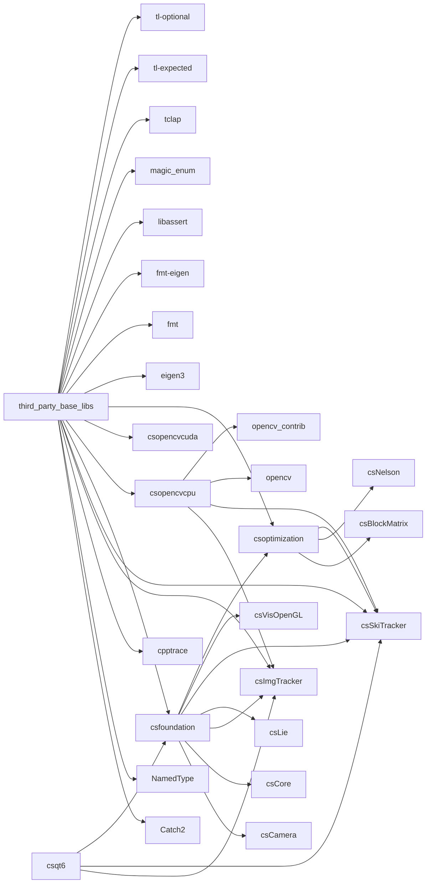

# The cscosine ecosystem

Generated by `scripts/ecosystem_report.py` from GitHub (nightly: `.github/workflows/ecosystem.yml`). Do not
edit: change the repositories, or the script.

## Needs attention

- [csCMake](https://github.com/cscosine/csCMake)
  - 2 commit(s) on `main` since v1.1.0, version still 1.1.0 (bump it: CONTRIBUTING.md, Versions)
- [csorchestrator](https://github.com/cscosine/csorchestrator)
  - 3 commit(s) on `main` since v0.1.2, version still 0.1.2 (bump it: CONTRIBUTING.md, Versions)
- [magic_enum](https://github.com/cscosine/magic_enum)
  - upstream has v0.10.0 (we are on v0.9.8)

## CI

The last real run (completed, not cancelled or skipped) of each workflow on `main`; the builds of the newest
tag that still exists (outer repositories); the last run of each workflow on `stable`. Each with the time it
started (Europe/Rome; 🕰️ older than 8 days).

| Repository | `main` (each workflow) | Last tag build | `stable` |
|---|---|---|---|
| [cs-pre-commit-hooks](https://github.com/cscosine/cs-pre-commit-hooks) | ✅ [ci](https://github.com/cscosine/cs-pre-commit-hooks/actions/runs/45085988995) 23 Nov 00:57 | `v1.0.0` ✅ [release](https://github.com/cscosine/cs-pre-commit-hooks/actions/runs/44982576787) 22 Nov 04:52 | – |
| [cs-project-template](https://github.com/cscosine/cs-project-template) | ✅ [ci](https://github.com/cscosine/cs-project-template/actions/runs/45086659412) 23 Nov 01:04 | `v1.2.3` ✅ [ci](https://github.com/cscosine/cs-project-template/actions/runs/45286311911) 24 Nov 00:09 | – |
| [csBlockMatrix](https://github.com/cscosine/csBlockMatrix) | ✅ [checks](https://github.com/cscosine/csBlockMatrix/actions/runs/45019743666) 22 Nov 12:56 | – | – |
| [csCamera](https://github.com/cscosine/csCamera) | ✅ [checks](https://github.com/cscosine/csCamera/actions/runs/45019734481) 22 Nov 12:56 | – | – |
| [csCMake](https://github.com/cscosine/csCMake) | ✅ [checks](https://github.com/cscosine/csCMake/actions/runs/45207749771) 23 Nov 16:39 ✅ [ci](https://github.com/cscosine/csCMake/actions/runs/45088056746) 23 Nov 01:19 ✅ [docs](https://github.com/cscosine/csCMake/actions/runs/45207750459) 23 Nov 16:39 ✅ [smoke](https://github.com/cscosine/csCMake/actions/runs/44928988602) 21 Nov 18:14 | `v1.1.0` ✅ [release](https://github.com/cscosine/csCMake/actions/runs/45216305064) 23 Nov 18:06 | ✅ [docs](https://github.com/cscosine/csCMake/actions/runs/45225940646) 23 Nov 18:16 |
| [csCore](https://github.com/cscosine/csCore) | ✅ [checks](https://github.com/cscosine/csCore/actions/runs/45019728048) 22 Nov 12:56 | – | – |
| [csfoundation](https://github.com/cscosine/csfoundation) | ✅ [checks](https://github.com/cscosine/csfoundation/actions/runs/45019767768) 22 Nov 12:56 ✅ [csfoundation](https://github.com/cscosine/csfoundation/actions/runs/45185390620) 23 Nov 14:35 | `v0.1.0` ✅ [csfoundation](https://github.com/cscosine/csfoundation/actions/runs/44999719820) 22 Nov 08:46 | – |
| [csImgTracker](https://github.com/cscosine/csImgTracker) | ✅ [checks](https://github.com/cscosine/csImgTracker/actions/runs/45281762308) 23 Nov 23:39 ✅ [csImgTracker](https://github.com/cscosine/csImgTracker/actions/runs/45281762139) 23 Nov 23:39 | `v0.2.2` ✅ [csImgTracker](https://github.com/cscosine/csImgTracker/actions/runs/45002938555) 22 Nov 09:27 | – |
| [csLie](https://github.com/cscosine/csLie) | ✅ [checks](https://github.com/cscosine/csLie/actions/runs/45019730763) 22 Nov 12:56 | – | – |
| [csNelson](https://github.com/cscosine/csNelson) | ✅ [checks](https://github.com/cscosine/csNelson/actions/runs/45019740215) 22 Nov 12:56 | – | – |
| [csopencvcpu](https://github.com/cscosine/csopencvcpu) | ✅ [checks](https://github.com/cscosine/csopencvcpu/actions/runs/45019763084) 22 Nov 12:56 ✅ [csopencvcpu](https://github.com/cscosine/csopencvcpu/actions/runs/45140090779) 23 Nov 09:37 | `v5.1.0-cpu.3` ✅ [csopencvcpu](https://github.com/cscosine/csopencvcpu/actions/runs/44991670275) 22 Nov 06:58 | – |
| [csopencvcuda](https://github.com/cscosine/csopencvcuda) | ✅ [checks](https://github.com/cscosine/csopencvcuda/actions/runs/45030259813) 22 Nov 14:58 ✅ [csopencvcuda](https://github.com/cscosine/csopencvcuda/actions/runs/45066508428) 22 Nov 21:27 | `v5.1.0-cuda.1-rc1` ✅ [csopencvcuda](https://github.com/cscosine/csopencvcuda/actions/runs/45030290737) 22 Nov 14:58 | – |
| [csoptimization](https://github.com/cscosine/csoptimization) | ✅ [checks](https://github.com/cscosine/csoptimization/actions/runs/45019771497) 22 Nov 12:56 ✅ [csoptimization](https://github.com/cscosine/csoptimization/actions/runs/45194897196) 23 Nov 15:30 | `v0.1.0` ✅ [csoptimization](https://github.com/cscosine/csoptimization/actions/runs/45001631628) 22 Nov 09:11 | – |
| [csorchestrator](https://github.com/cscosine/csorchestrator) | ✅ [checks](https://github.com/cscosine/csorchestrator/actions/runs/45278625256) 23 Nov 23:19 ✅ [ci](https://github.com/cscosine/csorchestrator/actions/runs/45278625204) 23 Nov 23:19 | – | – |
| [csqt6](https://github.com/cscosine/csqt6) | ✅ [checks](https://github.com/cscosine/csqt6/actions/runs/45019759619) 22 Nov 12:56 ✅ [csqt6](https://github.com/cscosine/csqt6/actions/runs/45089106279) 23 Nov 01:29 | `v6.12.0` ✅ [csqt6](https://github.com/cscosine/csqt6/actions/runs/44984322898) 22 Nov 05:16 | – |
| [csSkiTracker](https://github.com/cscosine/csSkiTracker) | ✅ [checks](https://github.com/cscosine/csSkiTracker/actions/runs/45019779722) 22 Nov 12:56 ✅ [csSkiTracker](https://github.com/cscosine/csSkiTracker/actions/runs/45210427925) 24 Nov 00:01 | `v0.1.0` ✅ [csSkiTracker](https://github.com/cscosine/csSkiTracker/actions/runs/45002986356) 22 Nov 09:28 | – |
| [csVisOpenGL](https://github.com/cscosine/csVisOpenGL) | ✅ [checks](https://github.com/cscosine/csVisOpenGL/actions/runs/45019737024) 22 Nov 12:56 | – | – |
| [csWiki](https://github.com/cscosine/csWiki) | ✅ [checks](https://github.com/cscosine/csWiki/actions/runs/45019825120) 22 Nov 12:57 ✅ [ci](https://github.com/cscosine/csWiki/actions/runs/45088127169) 23 Nov 01:19 ✅ [pages-build-deployment](https://github.com/cscosine/csWiki/actions/runs/45286815736) 24 Nov 00:12 | – | – |
| [fmt-eigen](https://github.com/cscosine/fmt-eigen) | ✅ [checks](https://github.com/cscosine/fmt-eigen/actions/runs/45020694203) 22 Nov 13:07 | – | – |
| [NamedType](https://github.com/cscosine/NamedType) | ✅ [checks](https://github.com/cscosine/NamedType/actions/runs/45020697446) 22 Nov 13:07 | – | – |
| [tclap](https://github.com/cscosine/tclap) | ✅ [checks](https://github.com/cscosine/tclap/actions/runs/45020700670) 22 Nov 13:07 | – | – |
| [third_party_base_libs](https://github.com/cscosine/third_party_base_libs) | ✅ [checks](https://github.com/cscosine/third_party_base_libs/actions/runs/45019756960) 22 Nov 12:56 ✅ [third_party_base_libs](https://github.com/cscosine/third_party_base_libs/actions/runs/45132698729) 23 Nov 08:39 | `v0.1.0` ✅ [third_party_base_libs](https://github.com/cscosine/third_party_base_libs/actions/runs/44989560064) 22 Nov 06:28 | – |

### Weekly queue

The scheduled runs on `main`, one project at a time (no shared runners), in dependency order: the hooks and the
template, the tools, csqt6 (Sunday evening), the build train (Monday night), the ecosystem update. From the `schedule:`
crons on `main` (UTC; shown in local time, so they move by an hour with summer time). A new outer project gets
its own slot after the projects it depends on. The last scheduled run: the last one the cron started on `main`
(✅ success, ❌ failed, ⚪ cancelled, ⏳ running), linked; 🕰️ older
than 8 days (the slot did not fire last week).

| When (Europe/Rome) | Repository | Workflow | Takes (shortest – longest of the last 5 successful runs) | Last scheduled run (Europe/Rome) |
|---|---|---|---|---|
| Sun 14:30 | [csopencvcuda](https://github.com/cscosine/csopencvcuda) | csopencvcuda | 3 h 14 m – 4 h 26 m | ✅ [22 Nov 21:27](https://github.com/cscosine/csopencvcuda/actions/runs/45066508428) |
| Sun 20:00 | [cs-pre-commit-hooks](https://github.com/cscosine/cs-pre-commit-hooks) | ci | 1 m | ✅ [23 Nov 00:57](https://github.com/cscosine/cs-pre-commit-hooks/actions/runs/45085988995) |
| Sun 20:00 | [cs-project-template](https://github.com/cscosine/cs-project-template) | ci | 1 m – 13 m | ✅ [23 Nov 01:04](https://github.com/cscosine/cs-project-template/actions/runs/45086659412) |
| Sun 20:15 | [csCMake](https://github.com/cscosine/csCMake) | ci | 3 m – 13 m | ✅ [23 Nov 01:19](https://github.com/cscosine/csCMake/actions/runs/45088056746) |
| Sun 20:15 | [csorchestrator](https://github.com/cscosine/csorchestrator) | ci | 4 m – 14 m | ✅ [23 Nov 01:14](https://github.com/cscosine/csorchestrator/actions/runs/45087641686) |
| Sun 20:15 | [csWiki](https://github.com/cscosine/csWiki) | ci | 2 m – 1 h 24 m | ✅ [23 Nov 01:19](https://github.com/cscosine/csWiki/actions/runs/45088127169) |
| Sun 20:50 | [csqt6](https://github.com/cscosine/csqt6) | csqt6 | 2 h 46 m – 3 h 56 m | ✅ [23 Nov 01:29](https://github.com/cscosine/csqt6/actions/runs/45089106279) |
| Mon 01:15 | [third_party_base_libs](https://github.com/cscosine/third_party_base_libs) | third_party_base_libs | 11 m – 33 m | ✅ [23 Nov 08:39](https://github.com/cscosine/third_party_base_libs/actions/runs/45132698729) |
| Mon 02:00 | [csopencvcpu](https://github.com/cscosine/csopencvcpu) | csopencvcpu | 2 h 05 m – 3 h 01 m | ✅ [23 Nov 09:37](https://github.com/cscosine/csopencvcpu/actions/runs/45140090779) |
| Mon 04:35 | [csfoundation](https://github.com/cscosine/csfoundation) | csfoundation | 18 m – 1 h 03 m | ✅ [23 Nov 14:35](https://github.com/cscosine/csfoundation/actions/runs/45185390620) |
| Mon 05:10 | [csoptimization](https://github.com/cscosine/csoptimization) | csoptimization | 14 m – 2 h 13 m | ✅ [23 Nov 15:30](https://github.com/cscosine/csoptimization/actions/runs/45194897196) |
| Mon 05:40 | [csImgTracker](https://github.com/cscosine/csImgTracker) | csImgTracker | 7 m – 21 m | ✅ [24 Nov 00:01](https://github.com/cscosine/csImgTracker/actions/runs/45203727231) |
| Mon 06:10 | [csSkiTracker](https://github.com/cscosine/csSkiTracker) | csSkiTracker | 9 m – 2 h 21 m | ✅ [24 Nov 00:01](https://github.com/cscosine/csSkiTracker/actions/runs/45210427925) |
| Daily 07:00 | [.github](https://github.com/cscosine/.github) | ecosystem | 3 m – 5 m | ⏳ [25 Nov 17:27](https://github.com/cscosine/.github/actions/runs/45654026937) |

## Versions (outer projects)

| Project | Final | Candidate | Commits on main since | stable |
|---|---|---|---|---|
| [cs-pre-commit-hooks](https://github.com/cscosine/cs-pre-commit-hooks) | v1.0.0 | – | 2 | at the last final |
| [cs-project-template](https://github.com/cscosine/cs-project-template) | – | – | – | – |
| [csCMake](https://github.com/cscosine/csCMake) | v1.1.0 | – | 2 | at the last final |
| [csfoundation](https://github.com/cscosine/csfoundation) | v0.1.0 | – | 10 | at the last final |
| [csImgTracker](https://github.com/cscosine/csImgTracker) | v0.2.2 | – | 9 | at the last final |
| [csopencvcpu](https://github.com/cscosine/csopencvcpu) | v5.1.0-cpu.3 | – | 7 | at the last final |
| [csopencvcuda](https://github.com/cscosine/csopencvcuda) | – | v5.1.0-cuda.1-rc1 | 3 | – |
| [csoptimization](https://github.com/cscosine/csoptimization) | v0.1.0 | – | 9 | at the last final |
| [csorchestrator](https://github.com/cscosine/csorchestrator) | – | – | – | – |
| [csqt6](https://github.com/cscosine/csqt6) | v6.12.0 | – | 11 | at the last final |
| [csSkiTracker](https://github.com/cscosine/csSkiTracker) | v0.1.0 | – | 7 | at the last final |
| [csWiki](https://github.com/cscosine/csWiki) | – | – | – | – |
| [third_party_base_libs](https://github.com/cscosine/third_party_base_libs) | v0.1.0 | – | 9 | at the last final |

## Dependencies (recipes on `main`)

| Project | csCMake | Providers (pinned release) | Builds (inner repository at ref) |
|---|---|---|---|
| [csfoundation](https://github.com/cscosine/csfoundation) | 1.1.0 | [third_party_base_libs `v0.1.0`](https://github.com/cscosine/third_party_base_libs/releases/tag/v0.1.0) [csqt6 `v6.12.0`](https://github.com/cscosine/csqt6/releases/tag/v6.12.0) | [csCore `main`](https://github.com/cscosine/csCore/tree/main) [csLie `main`](https://github.com/cscosine/csLie/tree/main) [csCamera `main`](https://github.com/cscosine/csCamera/tree/main) [csVisOpenGL `main`](https://github.com/cscosine/csVisOpenGL/tree/main) |
| [csImgTracker](https://github.com/cscosine/csImgTracker) | 1.1.0 | [third_party_base_libs `v0.1.0`](https://github.com/cscosine/third_party_base_libs/releases/tag/v0.1.0) [csfoundation `v0.1.0`](https://github.com/cscosine/csfoundation/releases/tag/v0.1.0) [csqt6 `v6.12.0`](https://github.com/cscosine/csqt6/releases/tag/v6.12.0) [csopencvcpu `v5.1.0-cpu.3`](https://github.com/cscosine/csopencvcpu/releases/tag/v5.1.0-cpu.3) | – |
| [csopencvcpu](https://github.com/cscosine/csopencvcpu) | 1.1.0 | [third_party_base_libs `v0.1.0`](https://github.com/cscosine/third_party_base_libs/releases/tag/v0.1.0) | [opencv `v5.1.0-cpu.3`](https://github.com/cscosine/opencv/tree/v5.1.0-cpu.3) [opencv_contrib `v5.1.0-cpu.3`](https://github.com/cscosine/opencv_contrib/tree/v5.1.0-cpu.3) |
| [csopencvcuda](https://github.com/cscosine/csopencvcuda) | 1.1.0 | [third_party_base_libs `v0.1.0`](https://github.com/cscosine/third_party_base_libs/releases/tag/v0.1.0) | – |
| [csoptimization](https://github.com/cscosine/csoptimization) | 1.1.0 | [csfoundation `v0.1.0`](https://github.com/cscosine/csfoundation/releases/tag/v0.1.0) [third_party_base_libs `v0.1.0`](https://github.com/cscosine/third_party_base_libs/releases/tag/v0.1.0) | [csNelson `main`](https://github.com/cscosine/csNelson/tree/main) [csBlockMatrix `main`](https://github.com/cscosine/csBlockMatrix/tree/main) |
| [csqt6](https://github.com/cscosine/csqt6) | – | – | – |
| [csSkiTracker](https://github.com/cscosine/csSkiTracker) | 1.1.0 | [third_party_base_libs `v0.1.0`](https://github.com/cscosine/third_party_base_libs/releases/tag/v0.1.0) [csfoundation `v0.1.0`](https://github.com/cscosine/csfoundation/releases/tag/v0.1.0) [csoptimization `v0.1.0`](https://github.com/cscosine/csoptimization/releases/tag/v0.1.0) [csqt6 `v6.12.0`](https://github.com/cscosine/csqt6/releases/tag/v6.12.0) [csopencvcpu `v5.1.0-cpu.3`](https://github.com/cscosine/csopencvcpu/releases/tag/v5.1.0-cpu.3) | – |
| [third_party_base_libs](https://github.com/cscosine/third_party_base_libs) | 1.1.0 | – | [eigen3 `v5.0.1-cs.2`](https://github.com/cscosine/eigen3/tree/v5.0.1-cs.2) [fmt `v12.2.1-cs.2`](https://github.com/cscosine/fmt/tree/v12.2.1-cs.2) [cpptrace `v1.0.4-cs.2`](https://github.com/cscosine/cpptrace/tree/v1.0.4-cs.2) [libassert `v2.2.1-cs.2`](https://github.com/cscosine/libassert/tree/v2.2.1-cs.2) [magic_enum `v0.9.8-cs.2`](https://github.com/cscosine/magic_enum/tree/v0.9.8-cs.2) [Catch2 `v3.16.1-cs.2`](https://github.com/cscosine/Catch2/tree/v3.16.1-cs.2) [tl-expected `v1.3.1-cs.2`](https://github.com/cscosine/tl-expected/tree/v1.3.1-cs.2) [tl-optional `v1.1.0-cs.2`](https://github.com/cscosine/tl-optional/tree/v1.1.0-cs.2) [NamedType `v1.1.0`](https://github.com/cscosine/NamedType/tree/v1.1.0) [tclap `v1.0.0`](https://github.com/cscosine/tclap/tree/v1.0.0) [fmt-eigen `v1.0.0`](https://github.com/cscosine/fmt-eigen/tree/v1.0.0) |

## Project template

Latest template: v1.2.3

| Repository | Kind | Template | Answers |
|---|---|---|---|
| [csBlockMatrix](https://github.com/cscosine/csBlockMatrix) | library | v1.2.3 | kind=library |
| [csCamera](https://github.com/cscosine/csCamera) | library | v1.2.3 | kind=library |
| [csCMake](https://github.com/cscosine/csCMake) | tool | v1.2.3 | kind=tool |
| [csCore](https://github.com/cscosine/csCore) | library | v1.2.3 | kind=library |
| [csfoundation](https://github.com/cscosine/csfoundation) | distribution | v1.2.3 | csorchestrator_version=v0.1.2, kind=project |
| [csImgTracker](https://github.com/cscosine/csImgTracker) | application | v1.2.3 | csorchestrator_version=v0.1.2, kind=project |
| [csLie](https://github.com/cscosine/csLie) | library | v1.2.3 | kind=library |
| [csNelson](https://github.com/cscosine/csNelson) | library | v1.2.3 | kind=library |
| [csopencvcpu](https://github.com/cscosine/csopencvcpu) | distribution | v1.2.3 | csorchestrator_version=v0.1.2, kind=project |
| [csopencvcuda](https://github.com/cscosine/csopencvcuda) | distribution | v1.2.3 | csorchestrator_version=v0.1.2, kind=project |
| [csoptimization](https://github.com/cscosine/csoptimization) | distribution | v1.2.3 | csorchestrator_version=v0.1.2, kind=project |
| [csorchestrator](https://github.com/cscosine/csorchestrator) | tool | v1.2.3 | kind=tool |
| [csqt6](https://github.com/cscosine/csqt6) | distribution | v1.2.3 | csorchestrator_version=v0.1.2, kind=project |
| [csSkiTracker](https://github.com/cscosine/csSkiTracker) | application | v1.2.3 | csorchestrator_version=v0.1.2, kind=project |
| [csVisOpenGL](https://github.com/cscosine/csVisOpenGL) | library | v1.2.3 | kind=library |
| [csWiki](https://github.com/cscosine/csWiki) | tool | v1.2.3 | kind=tool |
| [fmt-eigen](https://github.com/cscosine/fmt-eigen) | library | v1.2.3 | kind=library |
| [NamedType](https://github.com/cscosine/NamedType) | library | v1.2.3 | kind=library |
| [tclap](https://github.com/cscosine/tclap) | library | v1.2.3 | kind=library |
| [third_party_base_libs](https://github.com/cscosine/third_party_base_libs) | distribution | v1.2.3 | csorchestrator_version=v0.1.2, kind=project |

## Forks

A fork is an upstream release plus our commits (`cscosine/README.md` in the fork says why each one exists);
syncs: the `cs-fork-sync` skill.

| Fork | Upstream | Base | Our commits | Our tags on it | Newer upstream releases |
|---|---|---|---|---|---|
| [Catch2](https://github.com/cscosine/Catch2) | https://github.com/catchorg/Catch2 | `v3.16.1` | 2 | v3.16.1-cs.1, v3.16.1-cs.2 | – |
| [cpptrace](https://github.com/cscosine/cpptrace) | https://github.com/jeremy-rifkin/cpptrace | `v1.0.4` | 4 | v1.0.4-cs.1, v1.0.4-cs.2 | – |
| [eigen3](https://github.com/cscosine/eigen3) | https://gitlab.com/libeigen/eigen | `5.0.1` | 3 | v5.0.1-cs.1, v5.0.1-cs.2 | – |
| [fmt](https://github.com/cscosine/fmt) | https://github.com/fmtlib/fmt | `12.2.1` | 3 | v12.2.1-cs.1, v12.2.1-cs.2 | – |
| [libassert](https://github.com/cscosine/libassert) | https://github.com/jeremy-rifkin/libassert | `v2.2.1` | 5 | v2.2.1-cs.1, v2.2.1-cs.2 | – |
| [magic_enum](https://github.com/cscosine/magic_enum) | https://github.com/Neargye/magic_enum | `v0.9.8` | 3 | v0.9.8-cs.1, v0.9.8-cs.2 | v0.10.0 |
| [opencv](https://github.com/cscosine/opencv) | https://github.com/opencv/opencv | `5.1.0` | 8 | v5.1.0-cuda.1, v5.1.0-cpu.1, v5.1.0-cpu.2, v5.1.0-cpu.3 | – |
| [opencv_contrib](https://github.com/cscosine/opencv_contrib) | https://github.com/opencv/opencv_contrib | `5.1.0` | 3 | v5.1.0-cuda.1, v5.1.0-cpu.1, v5.1.0-cpu.2, v5.1.0-cpu.3 | – |
| [tl-expected](https://github.com/cscosine/tl-expected) | https://github.com/TartanLlama/expected | `v1.3.1` | 3 | v1.3.1-cs.1, v1.3.1-cs.2 | – |
| [tl-optional](https://github.com/cscosine/tl-optional) | https://github.com/TartanLlama/optional | `v1.1.0` | 4 | v1.1.0-cs.1, v1.1.0-cs.2 | – |

Copies of our own (upstream inactive, no syncs; a csCMake project of ours around the upstream files):

| Library | Came from | Our version |
|---|---|---|
| [fmt-eigen](https://github.com/cscosine/fmt-eigen) | https://github.com/RENyunfan/fmt-eigen | `1.0.0` |
| [NamedType](https://github.com/cscosine/NamedType) | https://github.com/joboccara/NamedType | `1.1.0` |
| [tclap](https://github.com/cscosine/tclap) | https://sourceforge.net/projects/tclap/ | `1.0.0` |

## Repositories

| Repository | Kind | Visibility | Default | Branches | Rulesets |
|---|---|---|---|---|---|
| [.github](https://github.com/cscosine/.github) | meta | public | main | main | – |
| [Catch2](https://github.com/cscosine/Catch2) | fork | public | main | main | fork-branches, tags-prerelease, tags-stable |
| [cpptrace](https://github.com/cscosine/cpptrace) | fork | public | main | feature/new-libs, main | fork-branches, tags-prerelease, tags-stable |
| [cs-pre-commit-hooks](https://github.com/cscosine/cs-pre-commit-hooks) | tool | public | main | main, stable | outer-main, tags-prerelease, tags-stable |
| [cs-project-template](https://github.com/cscosine/cs-project-template) | tool | public | main | main | outer-main, tags-prerelease, tags-stable |
| [csBlockMatrix](https://github.com/cscosine/csBlockMatrix) | library | public | main | main | inner-branches, tags-prerelease, tags-stable |
| [csCamera](https://github.com/cscosine/csCamera) | library | public | main | main | inner-branches, tags-prerelease, tags-stable |
| [csCMake](https://github.com/cscosine/csCMake) | tool | public | main | main, stable | outer-main, tags-prerelease, tags-stable |
| [csCore](https://github.com/cscosine/csCore) | library | public | main | main | inner-branches, tags-prerelease, tags-stable |
| [csfoundation](https://github.com/cscosine/csfoundation) | distribution | public | main | main, stable | outer-main, tags-prerelease, tags-stable |
| [csImgTracker](https://github.com/cscosine/csImgTracker) | application | public | main | main, stable | outer-main, tags-prerelease, tags-stable |
| [csLie](https://github.com/cscosine/csLie) | library | public | main | feature/cslie-accuracy, main | inner-branches, tags-prerelease, tags-stable |
| [csNelson](https://github.com/cscosine/csNelson) | library | public | main | main | inner-branches, tags-prerelease, tags-stable |
| [csopencvcpu](https://github.com/cscosine/csopencvcpu) | distribution | public | main | main, stable | outer-main, tags-prerelease, tags-stable |
| [csopencvcuda](https://github.com/cscosine/csopencvcuda) | distribution | public | main | main, stable | outer-main, tags-prerelease, tags-stable |
| [csoptimization](https://github.com/cscosine/csoptimization) | distribution | public | main | main, stable | outer-main, tags-prerelease, tags-stable |
| [csorchestrator](https://github.com/cscosine/csorchestrator) | tool | public | main | main, stable | outer-main, tags-prerelease, tags-stable |
| [csqt6](https://github.com/cscosine/csqt6) | distribution | public | main | main, stable | outer-main, tags-prerelease, tags-stable |
| [csSkiTracker](https://github.com/cscosine/csSkiTracker) | application | public | main | main, stable | outer-main, tags-prerelease, tags-stable |
| [csVisOpenGL](https://github.com/cscosine/csVisOpenGL) | library | public | main | main | inner-branches, tags-prerelease, tags-stable |
| [csWiki](https://github.com/cscosine/csWiki) | tool | public | main | main, stable | outer-main, tags-prerelease, tags-stable |
| [eigen3](https://github.com/cscosine/eigen3) | fork | public | main | main | fork-branches, tags-prerelease, tags-stable |
| [fmt](https://github.com/cscosine/fmt) | fork | public | main | main | fork-branches, tags-prerelease, tags-stable |
| [fmt-eigen](https://github.com/cscosine/fmt-eigen) | library | public | main | main | inner-branches, tags-prerelease, tags-stable |
| [libassert](https://github.com/cscosine/libassert) | fork | public | main | main | fork-branches, tags-prerelease, tags-stable |
| [magic_enum](https://github.com/cscosine/magic_enum) | fork | public | main | main | fork-branches, tags-prerelease, tags-stable |
| [NamedType](https://github.com/cscosine/NamedType) | library | public | main | main | inner-branches, tags-prerelease, tags-stable |
| [opencv](https://github.com/cscosine/opencv) | fork | public | main | cpu, cuda, main | fork-branches, tags-prerelease, tags-stable |
| [opencv_contrib](https://github.com/cscosine/opencv_contrib) | fork | public | main | cpu, cuda, main | fork-branches, tags-prerelease, tags-stable |
| [tclap](https://github.com/cscosine/tclap) | library | public | main | main | inner-branches, tags-prerelease, tags-stable |
| [third_party_base_libs](https://github.com/cscosine/third_party_base_libs) | distribution | public | main | feature/new-libs, main, stable | outer-main, tags-prerelease, tags-stable |
| [tl-expected](https://github.com/cscosine/tl-expected) | fork | public | main | main | fork-branches, tags-prerelease, tags-stable |
| [tl-optional](https://github.com/cscosine/tl-optional) | fork | public | main | main | fork-branches, tags-prerelease, tags-stable |
