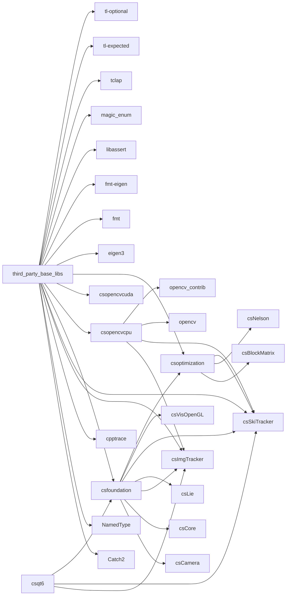

# The cscosine ecosystem

Generated by `scripts/ecosystem_report.py` from GitHub (nightly: `.github/workflows/ecosystem.yml`). Do not
edit: change the repositories, or the script.

## Needs attention

- [csCMake](https://github.com/cscosine/csCMake): 1 commit(s) on `main` since v1.0.0-rc8
- [csCMake](https://github.com/cscosine/csCMake): `stable` is not at a final release (last final: v0.4.0)
- [csImgTracker](https://github.com/cscosine/csImgTracker): `stable` is not at a final release (last final: v0.2.1)
- [csqt6](https://github.com/cscosine/csqt6): 2 commit(s) on `main` since v6.12.0-rc1
- [csopencvcuda](https://github.com/cscosine/csopencvcuda): csCMake 1.0.0-rc2, latest is v1.0.0-rc8
- [csopencvcuda](https://github.com/cscosine/csopencvcuda): pins third_party_base_libs v0.1.0-rc6, latest is v0.1.0-rc10
- [opencv](https://github.com/cscosine/opencv): upstream has 5.1.0 (we are on 5.0.0)
- [cs-project-template](https://github.com/cscosine/cs-project-template): last `main` run failure (https://github.com/cscosine/cs-project-template/actions/runs/44898047558)

## Versions (outer projects)

| Project | Final | Candidate | Commits on main since | stable |
|---|---|---|---|---|
| [cs-project-template](https://github.com/cscosine/cs-project-template) | – | – | – | – |
| [csCMake](https://github.com/cscosine/csCMake) | v0.4.0 | v1.0.0-rc8 | 1 | not at the last final |
| [csfoundation](https://github.com/cscosine/csfoundation) | – | v0.1.0-rc10 | 0 | – |
| [csImgTracker](https://github.com/cscosine/csImgTracker) | v0.2.1 | v0.2.2-rc1 | 0 | not at the last final |
| [csopencvcpu](https://github.com/cscosine/csopencvcpu) | – | v5.0.0-cpu.1-rc1 | 0 | – |
| [csopencvcuda](https://github.com/cscosine/csopencvcuda) | – | v5.0.1-rc3 | 0 | – |
| [csoptimization](https://github.com/cscosine/csoptimization) | – | v0.1.0-rc6 | 0 | – |
| [csorchestrator](https://github.com/cscosine/csorchestrator) | – | – | – | – |
| [csqt6](https://github.com/cscosine/csqt6) | – | v6.12.0-rc1 | 2 | – |
| [csSkiTracker](https://github.com/cscosine/csSkiTracker) | – | v0.1.0-rc4 | 0 | – |
| [csWiki](https://github.com/cscosine/csWiki) | – | – | – | – |
| [third_party_base_libs](https://github.com/cscosine/third_party_base_libs) | – | v0.1.0-rc10 | 0 | – |

## Dependencies (recipes on `main`)

| Project | csCMake | Providers (pinned) | Builds (inner, ref) |
|---|---|---|---|
| [csfoundation](https://github.com/cscosine/csfoundation) | 1.0.0-rc8 | third_party_base_libs `v0.1.0-rc10`, csqt6 `v6.12.0-rc1` | csCore, csLie, csCamera, csVisOpenGL (`main`) |
| [csImgTracker](https://github.com/cscosine/csImgTracker) | 1.0.0-rc8 | third_party_base_libs `v0.1.0-rc10`, csfoundation `v0.1.0-rc10`, csqt6 `v6.12.0-rc1`, csopencvcpu `v5.0.0-cpu.1-rc1` | – |
| [csopencvcpu](https://github.com/cscosine/csopencvcpu) | 1.0.0-rc8 | third_party_base_libs `v0.1.0-rc10` | opencv, opencv_contrib |
| [csopencvcuda](https://github.com/cscosine/csopencvcuda) | 1.0.0-rc2 | third_party_base_libs `v0.1.0-rc6` | – |
| [csoptimization](https://github.com/cscosine/csoptimization) | 1.0.0-rc8 | csfoundation `v0.1.0-rc10`, third_party_base_libs `v0.1.0-rc10` | csNelson, csBlockMatrix (`main`) |
| [csqt6](https://github.com/cscosine/csqt6) | – | – | – |
| [csSkiTracker](https://github.com/cscosine/csSkiTracker) | 1.0.0-rc8 | third_party_base_libs `v0.1.0-rc10`, csfoundation `v0.1.0-rc10`, csoptimization `v0.1.0-rc6`, csqt6 `v6.12.0-rc1`, csopencvcpu `v5.0.0-cpu.1-rc1` | – |
| [third_party_base_libs](https://github.com/cscosine/third_party_base_libs) | 1.0.0-rc8 | – | eigen3, fmt, cpptrace, libassert, magic_enum, Catch2, tl-expected, tl-optional, NamedType, tclap, fmt-eigen (`main`) |

## Project template

Latest template: v0.1.0

| Repository | Kind | Template | Answers |
|---|---|---|---|

Not on the template yet: [csBlockMatrix](https://github.com/cscosine/csBlockMatrix), [csCamera](https://github.com/cscosine/csCamera), [csCMake](https://github.com/cscosine/csCMake), [csCore](https://github.com/cscosine/csCore), [csfoundation](https://github.com/cscosine/csfoundation), [csImgTracker](https://github.com/cscosine/csImgTracker), [csLie](https://github.com/cscosine/csLie), [csNelson](https://github.com/cscosine/csNelson), [csopencvcpu](https://github.com/cscosine/csopencvcpu), [csopencvcuda](https://github.com/cscosine/csopencvcuda), [csoptimization](https://github.com/cscosine/csoptimization), [csorchestrator](https://github.com/cscosine/csorchestrator), [csqt6](https://github.com/cscosine/csqt6), [csSkiTracker](https://github.com/cscosine/csSkiTracker), [csVisOpenGL](https://github.com/cscosine/csVisOpenGL), [csWiki](https://github.com/cscosine/csWiki), [third_party_base_libs](https://github.com/cscosine/third_party_base_libs).

## Forks

| Fork | Upstream | Base | Our tags on it | Newer upstream releases |
|---|---|---|---|---|
| [Catch2](https://github.com/cscosine/Catch2) | https://github.com/catchorg/Catch2 | `v3.16.1` | v3.16.1-cs.1, v3.16.1-cs.2 | – |
| [cpptrace](https://github.com/cscosine/cpptrace) | https://github.com/jeremy-rifkin/cpptrace | `v1.0.4` | v1.0.4-cs.1, v1.0.4-cs.2 | – |
| [eigen3](https://github.com/cscosine/eigen3) | https://gitlab.com/libeigen/eigen | `5.0.1` | v5.0.1-cs.1, v5.0.1-cs.2 | – |
| [fmt](https://github.com/cscosine/fmt) | https://github.com/fmtlib/fmt | `12.2.1` | v12.2.1-cs.1, v12.2.1-cs.2 | – |
| [fmt-eigen](https://github.com/cscosine/fmt-eigen) | (a copy of our own) | | | |
| [libassert](https://github.com/cscosine/libassert) | https://github.com/jeremy-rifkin/libassert | `v2.2.1` | v2.2.1-cs.1, v2.2.1-cs.2 | – |
| [magic_enum](https://github.com/cscosine/magic_enum) | https://github.com/Neargye/magic_enum | `v0.9.8` | v0.9.8-cs.1, v0.9.8-cs.2 | – |
| [NamedType](https://github.com/cscosine/NamedType) | (a copy of our own) | | | |
| [opencv](https://github.com/cscosine/opencv) | https://github.com/opencv/opencv | `5.0.0` | v5.0.0-cpu.1 | 5.1.0 |
| [opencv_contrib](https://github.com/cscosine/opencv_contrib) | ? | ? | | |
| [tclap](https://github.com/cscosine/tclap) | (a copy of our own) | | | |
| [tl-expected](https://github.com/cscosine/tl-expected) | https://github.com/TartanLlama/expected | `v1.3.1` | v1.3.1-cs.1, v1.3.1-cs.2 | – |
| [tl-optional](https://github.com/cscosine/tl-optional) | https://github.com/TartanLlama/optional | `v1.1.0` | v1.1.0-cs.1, v1.1.0-cs.2 | – |

## Repositories

| Repository | Kind | Visibility | Default | Branches | Rulesets |
|---|---|---|---|---|---|
| [.github](https://github.com/cscosine/.github) | meta | public | main | main | – |
| [Catch2](https://github.com/cscosine/Catch2) | fork | public | main | main | fork-branches, tags-prerelease, tags-stable |
| [cpptrace](https://github.com/cscosine/cpptrace) | fork | public | main | main | fork-branches, tags-prerelease, tags-stable |
| [cs-project-template](https://github.com/cscosine/cs-project-template) | tool | public | main | main | outer-main, tags-prerelease, tags-stable |
| [csBlockMatrix](https://github.com/cscosine/csBlockMatrix) | library | public | main | main | inner-branches, tags-prerelease, tags-stable |
| [csCamera](https://github.com/cscosine/csCamera) | library | public | main | main | inner-branches, tags-prerelease, tags-stable |
| [csCMake](https://github.com/cscosine/csCMake) | tool | public | main | main, stable | outer-main, tags-prerelease, tags-stable |
| [csCore](https://github.com/cscosine/csCore) | library | public | main | main | inner-branches, tags-prerelease, tags-stable |
| [csfoundation](https://github.com/cscosine/csfoundation) | distribution | public | main | main, stable | outer-main, tags-prerelease, tags-stable |
| [csImgTracker](https://github.com/cscosine/csImgTracker) | application | public | main | main, stable | outer-main, tags-prerelease, tags-stable |
| [csLie](https://github.com/cscosine/csLie) | library | public | main | main | inner-branches, tags-prerelease, tags-stable |
| [csNelson](https://github.com/cscosine/csNelson) | library | public | main | main | inner-branches, tags-prerelease, tags-stable |
| [csopencvcpu](https://github.com/cscosine/csopencvcpu) | distribution | public | main | main, stable | outer-main, tags-prerelease, tags-stable |
| [csopencvcuda](https://github.com/cscosine/csopencvcuda) | distribution | public | main | main, stable | outer-main, tags-prerelease, tags-stable |
| [csoptimization](https://github.com/cscosine/csoptimization) | distribution | public | main | main, stable | outer-main, tags-prerelease, tags-stable |
| [csorchestrator](https://github.com/cscosine/csorchestrator) | tool | public | main | main, stable | outer-main, tags-prerelease, tags-stable |
| [csqt6](https://github.com/cscosine/csqt6) | distribution | public | main | main, stable | outer-main, tags-prerelease, tags-stable |
| [csSkiTracker](https://github.com/cscosine/csSkiTracker) | application | public | main | main, stable | outer-main, tags-prerelease, tags-stable |
| [csVisOpenGL](https://github.com/cscosine/csVisOpenGL) | library | public | main | main | inner-branches, tags-prerelease, tags-stable |
| [csWiki](https://github.com/cscosine/csWiki) | tool | public | main | feature/project-template, main, stable | outer-main, tags-prerelease, tags-stable |
| [eigen3](https://github.com/cscosine/eigen3) | fork | public | main | main | fork-branches, tags-prerelease, tags-stable |
| [fmt](https://github.com/cscosine/fmt) | fork | public | main | main | fork-branches, tags-prerelease, tags-stable |
| [fmt-eigen](https://github.com/cscosine/fmt-eigen) | fork | public | main | main | fork-branches, tags-prerelease, tags-stable |
| [libassert](https://github.com/cscosine/libassert) | fork | public | main | main | fork-branches, tags-prerelease, tags-stable |
| [magic_enum](https://github.com/cscosine/magic_enum) | fork | public | main | main | fork-branches, tags-prerelease, tags-stable |
| [NamedType](https://github.com/cscosine/NamedType) | fork | public | main | main | fork-branches, tags-prerelease, tags-stable |
| [opencv](https://github.com/cscosine/opencv) | fork | public | main | 2.4, 3.4, 4.x, 5.x, cpu, cuda, main, master, next | fork-branches, tags-prerelease, tags-stable |
| [opencv_contrib](https://github.com/cscosine/opencv_contrib) | fork | public | main-original | 3.4, 4.x, 5.x, dev-cpu, dev-cuda, main-cpu, main-cuda, main-original, master, next | fork-branches, fork-branches-dev, fork-branches-stable, tags-prerelease, tags-stable |
| [tclap](https://github.com/cscosine/tclap) | fork | public | main | main | fork-branches, tags-prerelease, tags-stable |
| [third_party_base_libs](https://github.com/cscosine/third_party_base_libs) | distribution | public | main | main, stable | outer-main, tags-prerelease, tags-stable |
| [tl-expected](https://github.com/cscosine/tl-expected) | fork | public | main | main | fork-branches, tags-prerelease, tags-stable |
| [tl-optional](https://github.com/cscosine/tl-optional) | fork | public | main | main | fork-branches, tags-prerelease, tags-stable |
