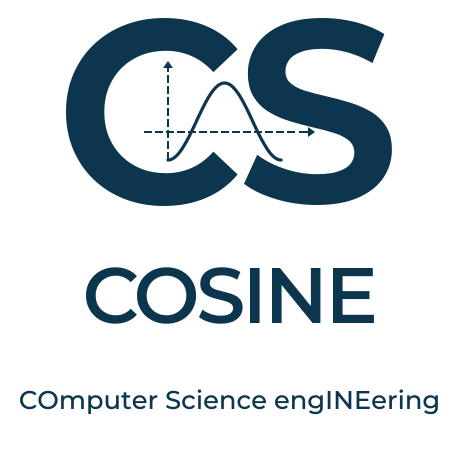

  

<h3 align="center">COmputer Science engINEering, from the first prototype to the product that ships.</h3>

  Computer vision · geometry · non-linear optimisation · modern C++ and Python

---

Most ideas die between the notebook and the release. **cscosine** is built for that gap: the science is done in
quick prototypes, then engineered into libraries and applications that build, test and release the same way on
Linux, Windows and macOS.

> The curve in the logo is an exact −cos *t* over one period: it starts on the ground, rises to the idea, and comes
> back down to earth as a product.

### How we work

| | |
|---|---|
| 🧪 **Prototype** | Try the idea fast, measure it, keep what works. |
| 🛠️ **Engineer** | One build system for every project, dependencies pinned to their releases, CI on the whole platform matrix: Ubuntu 22.04 / 24.04 / 26.04 (x64, arm64), Windows, macOS. |
| 📦 **Ship** | Tagged releases with ready-to-run archives; the licenses of what is inside respected and documented. |

### What lives here

| | Repositories |
|---|---|
| **Tooling** | [csCMake](https://github.com/cscosine/csCMake): CMake for families of C++ projects, presets for every platform · [csorchestrator](https://github.com/cscosine/csorchestrator): one Python script per project, run locally or as a generated CI, releases as binary packages |
| **Foundations** | [third_party_base_libs](https://github.com/cscosine/third_party_base_libs) · [csqt6](https://github.com/cscosine/csqt6) · [csopencvcpu](https://github.com/cscosine/csopencvcpu) / [csopencvcuda](https://github.com/cscosine/csopencvcuda) · [csfoundation](https://github.com/cscosine/csfoundation) · [csoptimization](https://github.com/cscosine/csoptimization) |
| **Applications** | [csImgTracker](https://github.com/cscosine/csImgTracker) · [csSkiTracker](https://github.com/cscosine/csSkiTracker) |
| **Documentation** | [csWiki](https://cscosine.github.io/csWiki/) |

### Principles

- **One way to do each thing**, written once and reused by every project.
- **Traceable**: every release is tagged and names the releases it was built from.
- **Open**: our code is MIT; third-party code keeps its license, and we say which.
