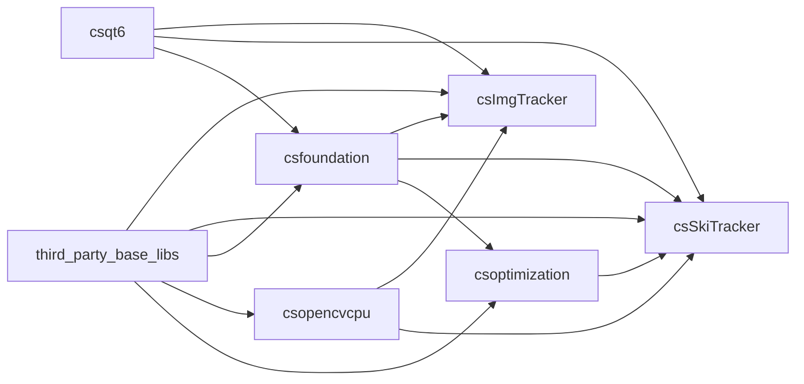

  

<h3 align="center">COmputer Science engINEering, from the first prototype to the product that ships.</h3>

  Computer vision · geometry · non-linear optimisation · modern C++ and Python

  <a href="https://github.com/cscosine/.github/blob/main/ECOSYSTEM.md">📊 Status</a> ·
  <a href="https://github.com/cscosine/.github/blob/main/plans/README.md">🗺️ Roadmap</a> ·
  <a href="https://cscosine.github.io/csWiki/">📚 Docs</a> ·
  <a href="https://github.com/cscosine/.github/blob/main/CONTRIBUTING.md">🤝 Contributing</a> ·
  <a href="https://github.com/cscosine/.github/blob/main/LICENSING.md">⚖️ Licensing</a>

---

Most ideas die between the notebook and the release. **cscosine** is built for that gap: the science is done in
quick prototypes, then engineered into libraries and applications that build, test and release the same way on
Linux, Windows and macOS.

> The curve in the logo is an exact −cos *t* over one period: it starts on the ground, rises to the idea, and comes
> back down to earth as a product.

### How we work

| | |
|---|---|
| 🧪 **Prototype** | Try the idea fast, measure it, keep what works. |
| 🛠️ **Engineer** | One build system for every project, dependencies pinned to their releases, CI on the whole platform matrix: Ubuntu 22.04 / 24.04 / 26.04 (x64, arm64), Windows, macOS. |
| 📦 **Ship** | Tagged releases with ready-to-run archives; the licenses of what is inside respected and documented. |

### What lives here

<!-- ecosystem:start -->

**Status** (updated nightly): 31 item(s) need attention · every repository, versions, dependencies, forks, template: [ECOSYSTEM.md](https://github.com/cscosine/.github/blob/main/ECOSYSTEM.md)

| Project | What it is | Release | Candidate | CI | Built on |
|---|---|---|---|---|---|
| **Tooling** | | | | | |
| [csCMake](https://github.com/cscosine/csCMake) | CMake for families of C++ projects: targets, packages, presets for every platform | [v0.4.0](https://github.com/cscosine/csCMake/releases/tag/v0.4.0) | [v1.0.0-rc9](https://github.com/cscosine/csCMake/releases/tag/v1.0.0-rc9) |  | – |
| [csorchestrator](https://github.com/cscosine/csorchestrator) | One Python script per project: run locally or as a generated CI, releases as binary packages | – | – |  | – |
| [cs-project-template](https://github.com/cscosine/cs-project-template) | Copier template: the shared files and rules of every repository, created and kept up to date | – | – |  | – |
| **Foundations** | | | | | |
| [third_party_base_libs](https://github.com/cscosine/third_party_base_libs) | Eigen, fmt, cpptrace, libassert, magic_enum, Catch2, ... built for every platform (builds [eigen3](https://github.com/cscosine/eigen3), [fmt](https://github.com/cscosine/fmt), [cpptrace](https://github.com/cscosine/cpptrace), [libassert](https://github.com/cscosine/libassert), [magic_enum](https://github.com/cscosine/magic_enum), [Catch2](https://github.com/cscosine/Catch2), [tl-expected](https://github.com/cscosine/tl-expected), [tl-optional](https://github.com/cscosine/tl-optional), [NamedType](https://github.com/cscosine/NamedType), [tclap](https://github.com/cscosine/tclap), [fmt-eigen](https://github.com/cscosine/fmt-eigen)) | – | [v0.1.0-rc11](https://github.com/cscosine/third_party_base_libs/releases/tag/v0.1.0-rc11) |  | – |
| [csqt6](https://github.com/cscosine/csqt6) | Qt 6 (LGPL modules) built for every platform | – | [v6.12.0-rc1](https://github.com/cscosine/csqt6/releases/tag/v6.12.0-rc1) |  | – |
| [csopencvcpu](https://github.com/cscosine/csopencvcpu) | OpenCV 5 (CPU) built for every platform (builds [opencv](https://github.com/cscosine/opencv), [opencv_contrib](https://github.com/cscosine/opencv_contrib)) | – | [v5.1.0-cpu.3-rc1](https://github.com/cscosine/csopencvcpu/releases/tag/v5.1.0-cpu.3-rc1) |  | [third_party_base_libs](https://github.com/cscosine/third_party_base_libs) `v0.1.0-rc10` |
| [csfoundation](https://github.com/cscosine/csfoundation) | The base C++ libraries: core, Lie groups, cameras, OpenGL visualisation (builds [csCore](https://github.com/cscosine/csCore), [csLie](https://github.com/cscosine/csLie), [csCamera](https://github.com/cscosine/csCamera), [csVisOpenGL](https://github.com/cscosine/csVisOpenGL)) | – | [v0.1.0-rc11](https://github.com/cscosine/csfoundation/releases/tag/v0.1.0-rc11) |  | [third_party_base_libs](https://github.com/cscosine/third_party_base_libs) `v0.1.0-rc10`, [csqt6](https://github.com/cscosine/csqt6) `v6.12.0-rc1` |
| [csoptimization](https://github.com/cscosine/csoptimization) | Non-linear optimisation libraries (builds [csNelson](https://github.com/cscosine/csNelson), [csBlockMatrix](https://github.com/cscosine/csBlockMatrix)) | – | [v0.1.0-rc7](https://github.com/cscosine/csoptimization/releases/tag/v0.1.0-rc7) |  | [csfoundation](https://github.com/cscosine/csfoundation) `v0.1.0-rc11`, [third_party_base_libs](https://github.com/cscosine/third_party_base_libs) `v0.1.0-rc10` |
| **Applications** | | | | | |
| [csImgTracker](https://github.com/cscosine/csImgTracker) | Image tracking application | [v0.2.1](https://github.com/cscosine/csImgTracker/releases/tag/v0.2.1) | [v0.2.2-rc2](https://github.com/cscosine/csImgTracker/releases/tag/v0.2.2-rc2) |  | [third_party_base_libs](https://github.com/cscosine/third_party_base_libs) `v0.1.0-rc10`, [csfoundation](https://github.com/cscosine/csfoundation) `v0.1.0-rc11`, [csqt6](https://github.com/cscosine/csqt6) `v6.12.0-rc1`, [csopencvcpu](https://github.com/cscosine/csopencvcpu) `v5.1.0-cpu.3-rc1` |
| [csSkiTracker](https://github.com/cscosine/csSkiTracker) | Ski tracking application | – | [v0.1.0-rc5](https://github.com/cscosine/csSkiTracker/releases/tag/v0.1.0-rc5) |  | [third_party_base_libs](https://github.com/cscosine/third_party_base_libs) `v0.1.0-rc10`, [csfoundation](https://github.com/cscosine/csfoundation) `v0.1.0-rc11`, [csoptimization](https://github.com/cscosine/csoptimization) `v0.1.0-rc7`, [csqt6](https://github.com/cscosine/csqt6) `v6.12.0-rc1`, [csopencvcpu](https://github.com/cscosine/csopencvcpu) `v5.1.0-cpu.3-rc1` |

The release chain (who builds on whom):

<!-- ecosystem:end -->

### Get started

| To | Do |
|---|---|
| Work on a project | `git clone` it, `./setup.sh` (Windows: `.\setup.ps1`), `source .venv/bin/activate`; its README says the rest |
| Start a new project | `copier copy gh:cscosine/cs-project-template <name>`: every repository is created and kept up to date from [cs-project-template](https://github.com/cscosine/cs-project-template) |
| Work with an AI agent | Claude Code reads each repository's rules (`CLAUDE.md`, `AGENTS.md`); the skills of the organisation: `/plugin marketplace add cscosine/.github`, then `/plugin install cs-org@cscosine` |
| Follow the work | [Status](https://github.com/cscosine/.github/blob/main/ECOSYSTEM.md) (nightly: versions, dependencies, what needs attention) · [Roadmap](https://github.com/cscosine/.github/blob/main/plans/README.md) (the plans and their steps) |
| Contribute | [How changes move](https://github.com/cscosine/.github/blob/main/CONTRIBUTING.md) (branches, PRs, releases) · [Rules](https://github.com/cscosine/cs-project-template/blob/main/template/.claude/cscosine-rules.md) |

Documentation: [csWiki](https://cscosine.github.io/csWiki/) · [csCMake](https://cscosine.github.io/csCMake/)

### Principles

- **One way to do each thing**, written once and reused by every project.
- **Traceable**: every release is tagged and names the releases it was built from.
- **Open**: our code is MIT; third-party code keeps its license, and we say which.
